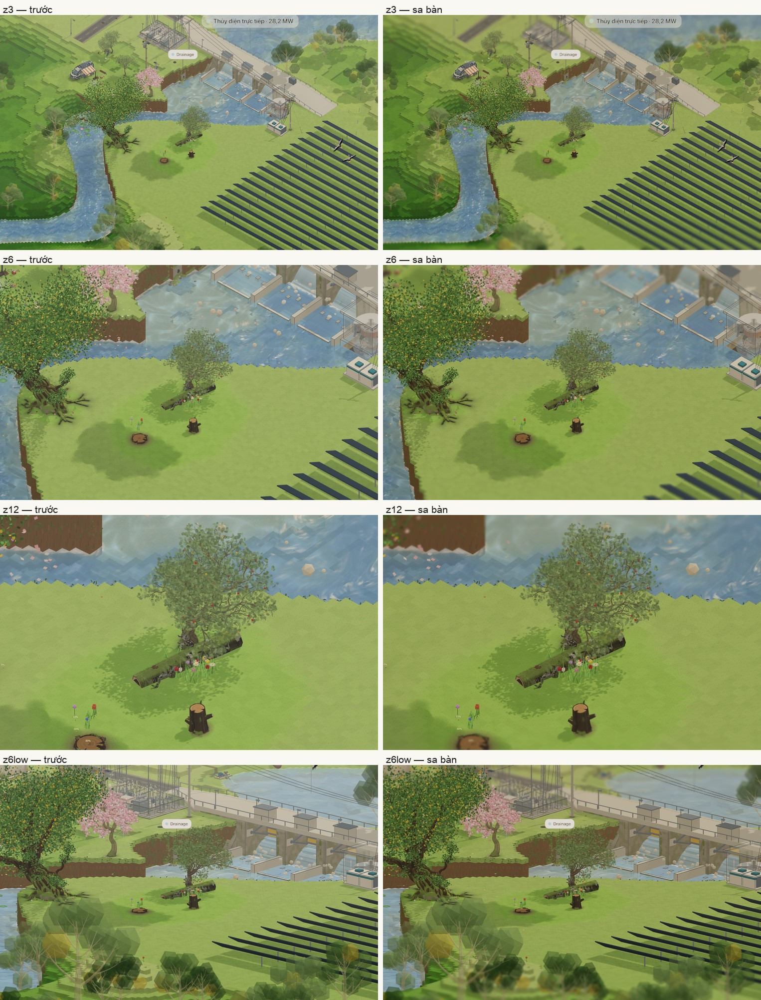
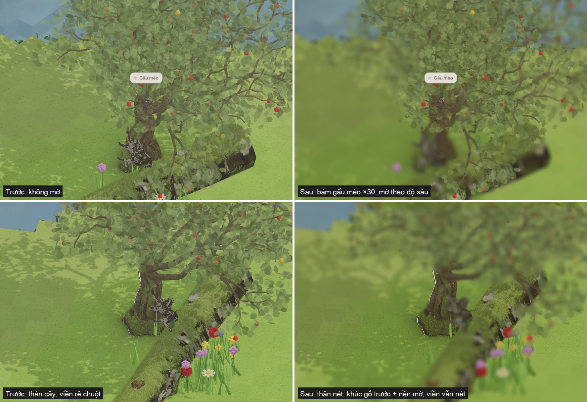
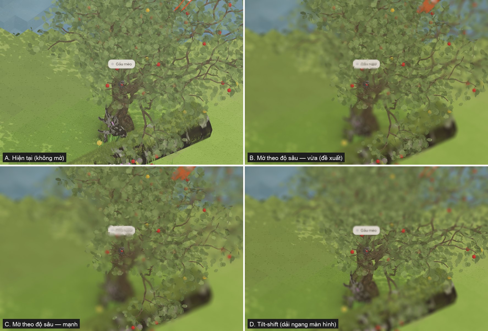
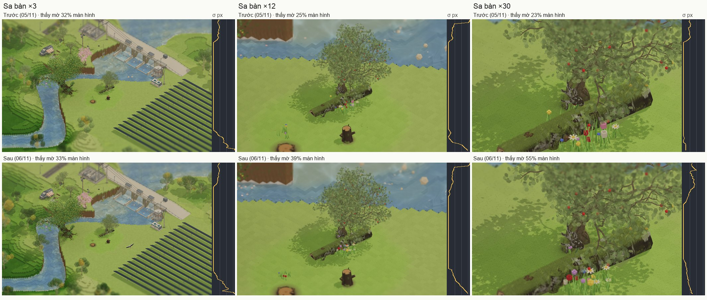
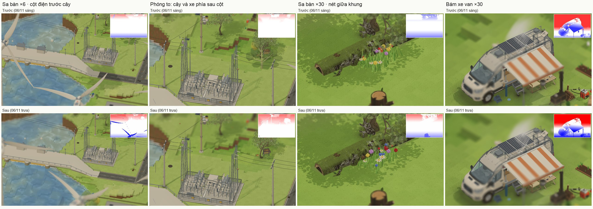

# Góc nhìn điện ảnh khi phóng cận — mờ hậu cảnh (depth of field)

Nghiên cứu 05/11/2026 theo yêu cầu G: "research n study về game cinematic view khi zoom in, close up, hiệu ứng blur mờ background".
Đã dựng thử trong 3D garden (camera bám gấu mèo trên cây táo già ×30).

**05/11: đã làm phương án A** (G "làm theo cách em đề xuất đi") — `src/app/core/lens.js`, mô tả ở ARCHITECTURE.md mục "Ống kính điện ảnh".

**05/11 tối: đã làm phương án B — sa bàn** (G hỏi mờ 25% viền, xem `blur-vien-25-*.jpg`, chọn dải trên + dưới, "tự nhiên nhất có thể"):
zoom ≥ ×3, mờ theo độ sâu thật (không theo vị trí điểm ảnh) và chỉ trong dải 25% trên + dưới. Ảnh: `cinematic-sa-ban.jpg`.

**06/11: chuyển nét → mờ không biên, vùng mờ rộng dần khi zoom gần** (G "blur effect sẽ tăng diện tích khi zoom closer … khoảng 20% … blend cái phần blur
và cái phần visible … không có biên giới, cường độ blur giảm dần") — mục 5, ảnh `blur-chuyen-mem-truoc-sau.jpg`.

**06/11 trưa: mờ theo độ xa gần của vật** (G "cột điện nằm phía trước thì vẫn rõ hơn so với cái cây nằm phía sau … độ mờ đi theo độ sâu của hình ảnh")
— mục 6, ảnh `mo-theo-do-sau-truoc-sau.jpg`.

## 1. Game làm thế nào

- **HD-2D (Octopath Traveler, Triangle Strategy — Square Enix):** thế giới 3D thật bên dưới, phủ tilt-shift + depth of field có bokeh ⇒ cảm giác sa bàn
  (diorama). Vì có độ sâu 3D thật nên mỗi khu vực đặt được một vùng nét hẹp riêng.
- **Cities: Skylines:** tilt-shift là hậu kỳ trong engine; vị trí vùng nét do camera tự chỉnh theo độ cao / góc, người chơi chỉnh độ mạnh.
- **Call of Duty (CoD4 → Advanced Warfare, Jorge Jimenez SIGGRAPH 2014):** chuẩn DOF hậu kỳ của game AAA — tính vòng nhoè (CoC) theo độ sâu,
  tách lớp gần / xa, làm ở nửa độ phân giải, gom mẫu hình đĩa (49 mẫu tròn, "scatter as gather") và chuẩn hoá trọng số.
- **Cảnh hội thoại / photo mode (RPG hiện đại):** khi cắt sang cận cảnh, camera đổi ống kính tele, hạ thấp ngang tầm nhân vật, lấy nét vào mặt người nói,
  hậu cảnh nhoè mạnh; chuyển nét (focus pull) mất ~0,5 s khi đổi người.

Điểm chung của "cinematic close-up":

| Thành phần | Làm gì | Ghi chú cho garden |
|---|---|---|
| Lấy nét tự động | tiêu cự = độ sâu của vật đang bám | `CAMF.o` có sẵn — chỉ cần chiếu vị trí vật lên trục nhìn |
| Vùng nét | ± một khoảng quanh tiêu cự vẫn nét | thử 0,6 m: thân + tán quanh gấu mèo nét, đất / gốc mờ |
| Độ nông theo zoom | phóng càng cận, vùng nét càng mỏng, mờ càng mạnh | ×16 nhẹ, ×30 đầy đủ, dưới ×16 tắt |
| Nhoè tiền cảnh | lá / cành ở trước vật mờ đè lên | thứ "bán" cảm giác điện ảnh nhất; gom mẫu xử lý được |
| Chuyển nét | đổi vật bám ⇒ tiêu cự trượt 0,4–0,8 s, không nhảy | lerp tiêu cự + độ mạnh theo thời gian |
| Bố cục | vật lệch 1/3 khung, camera hạ thấp hơn | `camFollow` đã có `off`; có thể thêm hạ góc khi ×30 |
| Đi kèm | vignette nhẹ, viền đen 2,39:1 (tuỳ), màu ấm hơn | tách riêng, bật / tắt độc lập |
| Chữ / giao diện | KHÔNG mờ | nhãn "Gấu mèo", viền rê chuột, bong bóng phải vẽ SAU lượt mờ |

**Tilt-shift khác DOF:** tilt-shift giữ nét một dải ngang màn hình, không cần độ sâu, rẻ — hợp nhìn xa toàn cảnh (sa bàn thu nhỏ). DOF theo độ sâu
hợp cận cảnh. Hai cái dùng ở hai đầu thang zoom, không thay nhau.

## 2. Camera của garden là trực giao (OrthographicCamera)

- Không có phối cảnh ⇒ không có "ống kính tele" thật; độ mờ phải tính theo khoảng cách độ sâu (mét), không theo công thức thấu kính.
- Thuận lợi: bộ đệm độ sâu trực giao là tuyến tính — `z = near + d·(far − near)`, đổi ra mét không cần phép chia.
- Ở ×30 màn hình ~100 điểm ảnh / m. Bản thử dùng CoC = (|z − zf| − 0,6 m) × 1% chiều cao khung / m, tối đa 1,6% khung (~10 điểm ảnh ở 600 px).

## 3. Cách làm trên three r160 (đã thử, đã đo màu)

1. Vẽ cảnh vào render target MSAA 4 mẫu có `DepthTexture` (UnsignedInt).
2. Gộp: quad toàn màn hình, 64 mẫu xoắn ốc tỉ lệ vàng (2,39996 rad), bán kính √((i+0,5)/64)·maxR. Mỗi mẫu tính lại CoC của chính nó và chỉ góp nếu
   CoC phủ tới tâm (scatter-as-gather); mẫu nằm SAU tâm bị kẹp CoC ≤ CoC tâm ⇒ hậu cảnh mờ không loang lên vật đang nét, còn tiền cảnh mờ vẫn đè lên được.

Bẫy gặp khi thử (đáng giá nhất của bản nghiên cứu này):

- **Render target thường (tuyến tính, HalfFloat) ⇒ cả khung bạc màu** (cỏ 129 so với 69 thật): shader tự viết của trang và nền không đi qua tone map /
  sRGB giống lúc vẽ ra màn hình.
- **Cách đúng màu:** đánh dấu `rt.isXRRenderTarget = true` ⇒ three áp tone map + mã hoá màu như vẽ ra màn hình. Nhưng nếu tạo RT với
  `colorSpace: SRGB` ngay từ đầu thì renderbuffer MSAA là SRGB8 còn texture là RGBA8 ⇒ `blitFramebuffer` lỗi 1282, khung đen. Sửa: tạo RT mặc định,
  `setRenderTarget(rt)` một lần để cấp bộ nhớ, rồi mới đặt `rt.texture.colorSpace = SRGBColorSpace` (định dạng đã cố định RGBA8, shader vẫn mã hoá sRGB).
- **Nền `scene.background` là lệnh xoá (glClear), không qua shader** ⇒ trong RT bị tối (194 thay 226): lúc vẽ vào RT tạm đặt nền = màu đã mã hoá sRGB.
- Sau sửa: nền khớp tuyệt đối, cỏ lệch ~5% (66,110,36 so với 72,118,48) — còn một vật liệu nào đó xử lý khác khi vẽ vào RT, cần dò khi làm thật.
- Phép mờ lấy mẫu trên giá trị sRGB (không tuyến tính) — điểm sáng bokeh hơi tối, chấp nhận được; muốn bokeh đẹp thì giải mã sRGB trong shader.

Chi phí: chỉ chạy khi camera bám vật và zoom ≥ ×16 (ngoài ra vẽ thẳng như hiện nay, không tốn gì). Làm thật nên tính CoC + gom mẫu ở nửa độ phân giải
rồi trộn lại; điện thoại 32 mẫu hoặc tắt. Mã shader ~3 KB, ngân sách gzip còn ~58 KB.

## 4. Đề xuất cho 3D garden (A, B đã làm; C chờ)

- **A. DOF theo độ sâu khi bám vật** (gấu mèo, drone, kỹ sư, cây táo…): mức B trong ảnh (vừa), mạnh dần ×16 → ×30, chuyển nét 0,6 s, nhãn + viền vẽ sau.
- **B. Tilt-shift nhẹ khi nhìn xa** (zoom mặc định): dải nét giữa màn hình, mép trên / dưới mờ ⇒ cảm giác sa bàn kiểu HD-2D.
- **C. Khung điện ảnh khi bám vật:** vignette nhẹ + (tuỳ) viền đen trên / dưới trượt vào 0,5 s.

Bản thử: `docs/dof-probe/dof1.js` (shader + cách dựng RT), `dof-probe/dof0b.js` (đo màu từng cách dựng RT) — chạy bằng bộ dò walkprobe / ev2.cjs của trang debug.

## 5. 06/11 — Chuyển nét → mờ không biên, vùng mờ rộng dần theo zoom

**Học được**

- **Biên đến từ cách trộn, không phải từ độ mờ.** GPU Gems 3 ch. 28 (Infinity Ward): mỗi điểm ảnh trộn tuyến tính từng đoạn giữa ảnh gốc, mờ nhỏ (17 mẫu ở
  toàn phân giải ≈ Gauss 1,4 px), mờ vừa (≈ 3,6 px) và mờ lớn theo vòng nhoè (CoC). Mức mờ nhỏ là bắt buộc — thiếu nó, ảnh như đang "cross-fade with a blurred
  version of itself" thay vì mờ dần liên tục. Bản 05/11 mắc đúng lỗi này: trộn thẳng ảnh nét với ảnh gom nửa phân giải trong dải CoC 0,75 → 2,5 px.
- **Bán kính gom theo từng điểm ảnh** (Jimenez, CoD: Advanced Warfare, SIGGRAPH 2014 — CoC lớn nhất theo ô, rồi lớn nhất các ô quanh): mẫu rải đúng đĩa cần,
  tiền cảnh mờ vẫn loang sang điểm nét bên cạnh. Rải mẫu trên bán kính lớn nhất của cả khung (bản 05/11) thì CoC nhỏ chỉ trúng vài mẫu — chỗ chuyển loang lổ.
- **Mắt người:** vết nhoè đủ nhỏ thì không phân biệt được với một điểm, vẫn thấy nét (vòng nhoè chấp nhận được — Wikipedia "Depth of field"). Ngưỡng phân biệt
  độ mờ có dạng "dipper": ở 0 kém nhạy hơn, nhạy nhất ở mức mờ nhỏ khác 0, mờ lớn thì theo luật Weber (thấy theo tỉ lệ) ⇒ chuyển nét → mờ phải bắt đầu
  dưới ngưỡng và tăng liền ở đoạn mờ nhỏ — đúng đoạn bản 05/11 có bậc.
- **Tilt-shift thấy "thu nhỏ" khi độ mờ khớp bố cục độ sâu** (Held, Cooper, O'Brien, Banks — ACM TOG 2010): dải mờ tuyến tính theo chiều dọc khung hoặc mờ
  theo độ sâu thật đều gây cảm giác sa bàn; tương quan mờ ↔ độ sâu chỉ cần hợp lý. Sa bàn của garden đã tính theo độ sâu thật — giữ.
- **Zoom gần ⇒ vùng mờ rộng ra là đúng quang học:** chụp càng gần, độ sâu trường ảnh càng mỏng ("photos taken at extremely close range … have a proportionally
  much smaller depth of field" — Wikipedia). Đề xuất của G (+ ~20 % diện tích khi zoom gần) đi đúng hướng này.

**Đã làm** (core/lens.js, ARCHITECTURE.md mục "Ống kính điện ảnh"):

1. 3 mức theo CoC từng điểm ảnh: nét → mờ nhỏ (4 mẫu song tuyến toàn phân giải, σ 0,87 px) → ảnh gom nửa phân giải. Ảnh nửa phân giải tự có σ ≈ 1 px (co
   2 × 2 + phóng song tuyến) nên bán kính gom trừ phần đó ⇒ σ tổng = CoC / 2 như đĩa thật, tăng liền.
2. Bán kính gom riêng từng điểm ảnh từ CoC lớn nhất ô 16 px + 3 × 3 ô quanh; điểm ảnh nét (bán kính < 0,5 px) bỏ qua lượt gom.
3. CoC qua chân bậc 2 ở ¼ đầu dải rồi tuyến tính — không gãy ở chỗ bắt đầu mờ.
4. Sa bàn: nửa dải nét 0,29 chiều cao khung ở ×3 → 0,15 ở ×30 (thang log zoom); độ mờ ở mép giữ 1 % chiều cao ⇒ dải chuyển rộng, thoải hơn.

**Số đo:** (1264 × 800, ảnh bật / tắt cùng khung; "thấy mờ" = σ hiệu dụng ≥ 0,3 px, liền từ mép vào)

| | ×3 | ×6 | ×12 | ×24 | ×30 | bám kỹ sư ×30 |
|---|---|---|---|---|---|---|
| Vùng thấy mờ 05/11 | 32 % | 28 % | 25 % | 17 % | 23 % | 70 % |
| Vùng thấy mờ 06/11 | 33 % | 35 % | 39 % | 52 % | 55 % | 74 % |
| Dốc σ lớn nhất ở dải chuyển mép trên, px / 1 % chiều cao (05/11 → 06/11) | 0,30 → 0,26 | 0,18 → 0,16 | 0,34 → 0,17 | 0,39 → 0,21 | 0,43 → 0,19 | 1,42 → 1,08 (cả khung) |

- Từ ×3 tới ×30 vùng thấy mờ tăng 33 → 55 % (+22 điểm). Bản 05/11 ngược lại: zoom càng gần vùng mờ càng co (32 → 23 %), vì dải nét cố định mà mờ theo
  độ sâu yếu dần. Muốn tăng ít / nhiều hơn: chỉ đổi `LENS_TS_A1` (0,15).
- Ví dụ ×12 mép trên: bản cũ σ rơi 0,53 → 0 trong ~2 % chiều cao (một đường); bản mới giảm 0,7 → 0 trên ~10 %.
- Lệnh vẽ thêm khi bật ống kính (lb3.js + lb4.js, 4 lần đo, trung vị; headless 1264 × 800; máy đang bận nên dao động 0,5–9 ms): cũ ×6 4,0 / ×24 3,6 /
  ×30 3,3 / bám 1,7 ms — mới 2,2 / 3,0 / 4,2 / 2,0 ms ⇒ cùng mức trong độ nhiễu (×30 mới ~+1 ms vì diện tích mờ gấp đôi).
- RAM đồ hoạ +2 ảnh ô (~79 × 50 RGBA, ~16 KB mỗi ảnh). gzip 737 / 775 KB (+1 KB). Test 19 / 0.

Dò: `dof-probe/lb1.js` (ảnh bật / tắt cùng khung ở ×3 / ×6 / ×12 / ×24 / ×30 + bám kỹ sư ×30), `dof-probe/lb-prof.py` (σ hiệu dụng từng dải 16 hàng),
`dof-probe/lb2.js` (bản đồ CoC + ảnh gom), `dof-probe/lb3.js` + `dof-probe/lb4.js` (thời gian lệnh vẽ bật / tắt; lb4 xen kẽ 8 × 20 khung
trong cùng lần tải), `dof-probe/lb-area.py` (vùng thấy mờ + dốc σ từ kết quả lb-prof.py; `BAND=8` cho dải 8 hàng).

## 6. 06/11 trưa — Mờ theo độ xa gần của vật (cột trước nét, cây sau mờ)

Góc trên phải mỗi ảnh: bản đồ vòng nhoè — trắng = nét, đỏ = mờ vì ở sau chỗ lấy nét, xanh = mờ vì ở trước (đậm hẳn = 16 px nửa phân giải).

**Bản sáng sai ở đâu**

- Sa bàn có kẹp theo dải màn hình: chỉ được mờ ngoài ± 30 % quanh tâm khung. Vật ở nửa trên khung bị mờ theo chỗ nó nằm trên màn hình chứ không theo
  khoảng cách; cột điện cao mờ dần từ gốc lên ngọn như mặt đất phía sau nó (ảnh trên, cột 2: cây và xe sau cột nét ngang cột).
- Tiêu cự đặt ở điểm nhìn của camera (y = 5, thấp hơn mặt cao nguyên 7,1) ⇒ chỗ nét thật lệch 3–4 m ra sau vật đang ở giữa khung; góc ×30 gần như
  không có điểm ảnh nào "phía sau tiêu cự" (bản đồ cũ toàn xanh).

**Học được**

- **Mờ khớp độ sâu thật cho cảm giác đúng nhất** (Held, Cooper, O'Brien, Banks 2010): dải mờ dọc khung chỉ là xấp xỉ, càng kém khi cảnh càng không phẳng —
  đúng chỗ cột điện, cây, tua-bin đứng trên mặt đất.
- **Thấu kính mỏng** (Potmesil & Chakravarty 1981): vòng nhoè c ∝ |z − z_f| / z — sau chỗ lấy nét, mờ tăng dần rồi tiến tới một giới hạn; trước chỗ lấy nét
  tăng không giới hạn. Bản sáng dừng ở mức tối đa ⇒ vật vừa qua mép dải mờ và núi xa hàng trăm mét mờ như nhau.
- **Mặt phẳng nét nghiêng (tilt-shift, Scheimpflug)**: ảnh sa bàn thật nghiêng ống kính để mặt phẳng nét cắt mặt đất theo góc dốc ⇒ chỉ một dải đất mỏng
  nét. Mặt phẳng nét ĐỨNG là trường hợp dốc nhất: trên mặt đất vẫn là một dải hẹp (giữ kiểu sa bàn), còn vật đứng ở đúng khoảng cách nét cả
  từ gốc tới ngọn. Độ sâu nhìn thẳng của camera (mặt phẳng nét vuông góc hướng nhìn) không làm được: góc cúi ~38°, tán cây cao 10 m gần camera hơn gốc
  ~6 m ⇒ tán cây SAU cột lại nét (đã thử, `pt2.js`).
- **Lấy nét tự động giữa khung** (Cinemachine Auto Focus, chế độ "Screen Center": đọc ảnh độ sâu ở giữa màn hình trong một bán kính nhỏ — mặc định 0,02 —
  rồi làm mượt): tiêu cự theo thứ đang ở giữa khung, không theo điểm nhìn ẩn dưới đất. Unreal Cinematic DOF cũng tính CoC từ camera thật (tiêu cự, khẩu độ,
  khoảng lấy nét).
- **Tiền cảnh mờ phải loang lên nền nét** (Schedl & Wimmer, partial occlusion): lượt gom của garden có độ phủ tiền cảnh từ 05/11 ⇒ cánh tua-bin, dây điện
  sát camera mờ loang ra, không viền cứng.

**Đã làm** (core/lens.js, ARCHITECTURE.md mục "Ống kính điện ảnh"):

1. CoC theo khoảng cách NGANG tới camera: h = độ sâu · cos α + (v − 0,5) · cao khung · sin α (α góc cúi, camera trực giao). Vật đứng có cùng h từ gốc
   tới ngọn ⇒ mờ đều như đất dưới chân nó. Trên mặt đất h đổi y như dải cũ (1 % chiều cao khung = cao khung / sin α m) ⇒ sa bàn rộng dần theo zoom
   (bản sáng) giữ nguyên. Bỏ kẹp màn hình. Bám vật đổi thông số sang h (rg / cos α, K · cos α) ⇒ trên mặt đất như cũ.
2. Lấy nét tự động: lượt 1 × 1 điểm ảnh đọc 5 × 5 điểm trong ô ± 3 % giữa khung, bỏ điểm trời, lấy trung vị h, trượt ~0,3 s; lưu tương đối điểm nhìn
   (± 200 m) trong 2 ảnh 1 × 1 RGBA8 xoay vòng. Bám vật vẫn lấy nét ở vật.
3. Đuôi xa: qua mức tối đa, mờ tăng tiếp tới ×2 theo hàm hữu tỉ (đạo hàm liền) ⇒ càng xa sau chỗ nét càng mờ, dần tới giới hạn như thấu kính mỏng.

**Số đo** (pt2.js + lb1c.js, 1264 × 800; % điểm ảnh có CoC ≥ 0,3 px nửa phân giải ≈ σ ≥ 0,3 px — `coc-area.py`; điểm nhìn y = 5 như khi kéo thật)

| | cây táo ×3 | ×12 | ×30 | cột #1 ×6 | ×12 | ×24 | bám kỹ sư ×30 |
|---|---|---|---|---|---|---|---|
| Diện tích mờ, bản sáng | 31 % | 43 % | 47 % | 37 % | 41 % | 42 % | 85 % |
| Diện tích mờ, bản trưa | 37 % | 45 % | 53 % | 47 % | 48 % | 59 % | 87 % |
| Trong đó phía sau tiêu cự (sáng → trưa) | 14 → 20 % | 11 → 20 % | 0 → 26 % | 15 → 27 % | 14 → 27 % | 2 → 31 % | 49 → 46 % |

- Zoom gần vẫn mờ rộng ra: cây táo ×3 → ×30 37 → 53 % (+16 điểm), cột #1 ×6 → ×24 47 → 59 %.
- Lấy nét: lệch −3,2 … −4,1 m so với điểm nhìn (đúng thứ ở giữa khung); 25 điểm lấy nét đều CoC 0,1 px ở góc cây táo ×30, cột ×6 / ×24.
- Góc `lb1.js` (điểm nhìn nâng lên gốc cây táo + 1 m): `lb-prof.py` (σ theo cả hàng) báo ×24 / ×30 tụt 52 / 55 → 20 / 23 % — do cách đo, không phải
  bớt mờ: tán cây đứng ở chỗ lấy nét nét suốt hàng, kéo σ cả hàng về 0. Đo từng điểm ảnh cùng góc: 46 / 46 → 49 / 56 %. Mờ theo vật nên đo theo
  điểm ảnh, không theo hàng.
- Lệnh vẽ thêm khi bật (lb4.js, 2 lần, trung vị từng cặp bật / tắt, headless): bản sáng ×6 1,8 / ×24 2,1 / ×30 1,9 / bám 2,1 ms — bản trưa 2,0 / 2,1 /
  2,4 / 2,2 ms (lượt lấy nét: 625 phép so sánh trên 1 điểm ảnh). RAM đồ hoạ +8 byte (2 ảnh 1 × 1). gzip 738 / 775 KB (+1 KB). Test 19 / 0.

Dò: `dof-probe/pt0.js` (toạ độ cột điện, cây), `dof-probe/pt2.js` (ảnh bật / tắt + bản đồ CoC: cột #1 ×6 / ×12 / ×24, cây táo ×3 / ×12 / ×30, bám kỹ sư
×30; tiêu cự tự động), `dof-probe/lb1c.js` (bản đồ CoC ở góc lb1.js), `dof-probe/coc-area.py` (diện tích mờ từng điểm ảnh, cũ / mới),
`dof-probe/pt-fig.py` (ảnh so sánh).

## Nguồn

- [HD-2D — Wikipedia](https://en.wikipedia.org/wiki/HD-2D)
- [Octopath Traveler II — Unreal Engine developer interview](https://www.unrealengine.com/developer-interviews/octopath-traveler-ii-builds-a-bigger-bolder-world-in-its-stunning-hd-2d-style?lang=en-US)
- [Next Generation Post Processing in Call of Duty: Advanced Warfare — Jorge Jimenez](https://www.iryoku.com/next-generation-post-processing-in-call-of-duty-advanced-warfare/)
- [GPU Gems 3, ch. 28 — Practical Post-Process Depth of Field](https://developer.nvidia.com/gpugems/gpugems3/part-iv-image-effects/chapter-28-practical-post-process-depth-field)
- [pmndrs postprocessing — DepthOfFieldEffect](https://pmndrs.github.io/postprocessing/public/docs/file/src/effects/DepthOfFieldEffect.js.html)
- [three.js forum — tilt shift on a 3D scene](https://discourse.threejs.org/t/how-to-have-a-tilt-shift-effect-on-a-3d-scene/40606)
- [luma.gl — Tilt Shift pass](https://luma.gl/docs/api-reference/shadertools/shader-passes/tilt-shift)
- [Physically Motivated Tilt Depth of Field in Unity](https://luniversity.github.io/)
- [Held, Cooper, O'Brien, Banks 2010 — Using Blur to Affect Perceived Distance and Size](https://pmc.ncbi.nlm.nih.gov/articles/PMC3088122)
- [Blur discrimination across the visual field — dipper, luật Weber](https://pmc.ncbi.nlm.nih.gov/articles/PMC5425112)
- [Depth of field — Wikipedia](https://en.wikipedia.org/wiki/Depth_of_field)
- [AMD FidelityFX — Depth of Field](https://gpuopen.com/manuals/fidelityfx_sdk/techniques/depth-of-field/)
- [Cinemachine Auto Focus — Unity](https://docs.unity3d.com/Packages/com.unity.cinemachine@3.1/manual/CinemachineAutoFocus.html)
- [Cinematic Depth of Field — Unreal Engine](https://dev.epicgames.com/documentation/en-us/unreal-engine/cinematic-depth-of-field-in-unreal-engine)
- [Circle of confusion — Wikipedia](https://en.wikipedia.org/wiki/Circle_of_confusion)
- [Scheimpflug principle — Wikipedia](https://en.wikipedia.org/wiki/Scheimpflug_principle)
- [Schedl, Wimmer — Simulating partial occlusion in post-processing depth-of-field methods](https://pure.fh-ooe.at/en/publications/simulating-partial-occlusion-in-post-processing-depth-of-field-me/)
